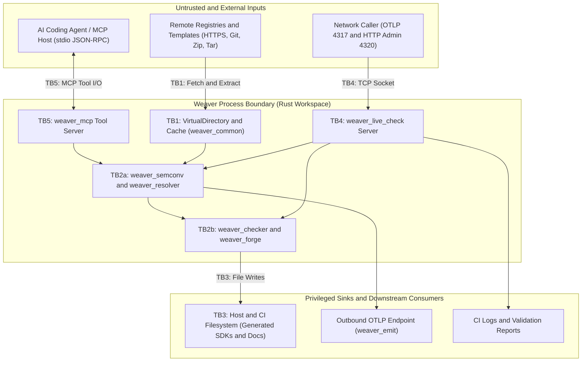

# Threat model

See the [OpenTelemetry Security Policy][otel-security-policy] and
[Security Response Guidelines][otel-security-response] for OpenTelemetry
projects.

This document defines the artifact-specific threat model for OpenTelemetry
Weaver. Where this document explicitly specifies security boundaries,
assumptions, or scope exclusions, it takes precedence over the default
OpenTelemetry security model for Weaver; otherwise, the organization-wide
security policy applies.

## What this project does and where untrusted input enters

OpenTelemetry Weaver is a multi-crate Rust platform for defining, resolving,
validating, generating code and documentation from, and live-checking telemetry
against OpenTelemetry Semantic Conventions and schemas. Although often treated
as a developer CLI, Weaver sits at a high-leverage supply-chain choke point
because its code generator produces source code shipped inside official
OpenTelemetry SDKs, Collector components, and instrumented services.

Weaver operates across five execution modes with distinct exposure profiles:

- **Schema Compiler and Code Generator (`registry check`, `resolve`,
  `generate`, `package`, `diff`, `update-markdown`):** Runs on developer
  workstations and privileged CI runners (often holding repository write tokens
  or release credentials) to compile YAML registries, Rego policies, `jaq`
  filters, and Jinja2 templates into SDK code and documentation.
- **Networked Live Telemetry Verifier (`registry live-check`):** Binds a local
  OTLP gRPC receiver (default port `4317`) and an unauthenticated HTTP admin
  control server (default port `4320`) to validate live application telemetry
  streams during local testing and CI pipelines.
- **Model Context Protocol Server (`registry mcp`):** Exposes semantic
  convention search and inspection tools over stdio JSON-RPC to AI coding
  assistants and LLM hosts, bridging external schema prose directly into agent
  context windows.
- **OTLP Signal Emitter (`registry emit`):** Acts as an outbound OTLP client
  synthesizing telemetry from resolved registries toward configured collector
  endpoints.
- **Local Registry Web Server (`serve`):** Serves a resolved registry over an
  HTTP API and embedded web UI (bound to `127.0.0.1:8080` by default, with
  optional `--cors-origins`) for local browsing and search.

### Untrusted inputs

- Remote registries, federated schema URLs, archives (`.zip`, `.tar.gz`), and
  Git repositories fetched via `VirtualDirectory` (`vdir`).
- Contributed YAML schema definitions, Rego policy bundles, `jaq` filters, and
  Jinja2 templates (commonly evaluated in CI on pull requests or from
  third-party dependencies).
- Inbound network traffic received by `registry live-check` on the OTLP gRPC
  receiver (`:4317`) and HTTP admin control server (`:4320`), as well as HTTP
  requests to `weaver serve` (`:8080`).
- Live telemetry attribute values ingested during `live-check` that may contain
  secrets, credentials, or PII before serialization into reports or CI logs.
- Tool-call arguments from LLM hosts to `weaver_mcp` and external schema prose
  (`brief`, `note`, `examples`) returned into agent context windows.
- Responses from remote HTTP endpoints, Git remotes, GitHub APIs, or OTLP
  collectors that Weaver contacts.

### Trusted and build-time inputs

- Operator-controlled CLI flags, environment variables, and local configuration
  files (`weaver.toml`), except where a value allows untrusted schema, policy,
  or template content to exceed its documented intent.
- Schema definitions, Rego policies, and Forge templates are build-time inputs
  meant to describe telemetry and produce code or documentation. Producing the
  documented output declared by a template is intended behavior; escaping the
  output directory, injecting code through non-code fields, or executing
  unintended host actions is in scope as a security vulnerability.

## Architecture and trust boundaries

Data crosses six trust boundaries as Weaver ingests external registries,
evaluates policies and templates, writes artifacts, accepts network telemetry,
and interacts with AI agents.

Figure 1: OpenTelemetry Weaver data flows and trust boundaries (TB1 through
TB5; TB6 covers the build and release supply chain).

### Trust boundary summary

- **TB1 (Remote and Archive Ingestion):** Crossed when `VirtualDirectory`
  fetches remote HTTP(S) URLs, performs Git fetches (optionally using host
  credentials via `--allow-git-credentials`), queries remote release endpoints,
  or extracts `.zip` and `.tar.gz` archives into local cache directories
  (`.weaver/vdir_cache`).
- **TB2 (Untrusted Schema, Policy, and DSL Evaluation):** Crossed when
  deserializing YAML/JSON and executing Turing-adjacent or high-complexity
  evaluators (schema inheritance graphs, `regorus` Rego policies, `jaq`
  queries, and `minijinja` templates).
- **TB3 (Filesystem and Downstream Code-Generation Sink):** Crossed when
  `weaver_forge` or `update-markdown` writes files to disk, and downstream when
  generated SDK source code is compiled into trusted application binaries.
- **TB4 (Live-Check Network Boundary):** Crossed when `weaver_live_check`
  accepts unauthenticated TCP connections on its OTLP receiver (`:4317`) and
  HTTP admin port (`:4320`), and when sampled live telemetry values are written
  to CI logs or reports.
- **TB5 (Agentic MCP Boundary):** Crossed when `weaver_mcp` ingests tool
  parameters from an LLM host and returns external semantic convention text
  (`brief`, `note`, `examples`) into the LLM prompt context.
- **TB6 (Build and Release Supply Chain):** Crossed during Cargo dependency
  resolution, GitHub Actions CI/CD execution, OCI container publishing
  (`otel/weaver`), and downstream GitHub Action consumption.

## Components that matter most / least

### Most security-critical components

The table below maps Weaver workspace crates to their primary untrusted inputs
and security-critical operations.

| Workspace Crate / Module | Core Responsibility | Primary Untrusted Inputs & Privileged Sinks |
| --- | --- | --- |
| `weaver_common` | `VirtualDirectory` (`vdir`) loader, HTTP auth, local cache, diagnostics, `WResult` | Local paths, `.zip`/`.tar.gz` archives, HTTP(S) URLs, Git fetches (`gix`), local cache filesystem mutations |
| `weaver_semconv` & `weaver_resolver` | YAML schema parsing (`serde-saphyr`), V1/V2 lineage, inheritance resolution | Untrusted YAML files, federated schema URLs, cyclic or deep reference graphs |
| `weaver_checker` | OPA Rego policy evaluation (via `regorus`) | Rego policy bundles, resolved schema JSON, violation severity classification |
| `weaver_forge` & `weaver_semconv_gen` | `jaq` filtering, `minijinja` rendering, file generation | Jinja2 templates, `jaq` filters, filesystem writes under target output directories |
| `weaver_live_check` & `src/registry/otlp` | OTLP gRPC ingestion, HTTP admin control, compliance reports | Inbound OTLP protobuf streams (`:4317`), HTTP control requests (`:4320`), report files |
| `weaver_mcp` | Model Context Protocol stdio JSON-RPC server | LLM tool-call arguments, registry prose returned into LLM context windows |
| `weaver_emit` | Outbound OTLP emission | Target OTLP URLs/headers, synthesized telemetry payloads |
| `src/serve` & `weaver_search` | Local HTTP API, embedded web UI, registry search | Inbound HTTP requests (`:8080`), CORS configuration, search queries |

### Least security-critical components

Still in scope, but lower priority because they primarily operate on internal
data models or compile-time metadata without directly crossing external trust
boundaries:

- `weaver_macros`, `weaver_version`, `weaver_diff`, `weaver_resolved_schema`,
  `weaver_otel_schema`, and `weaver_infer` (outside their direct YAML/JSON
  deserialization paths).

### Out-of-scope repository paths

- Test suites, harnesses, and fixtures: `tests/`, `data/`,
  `crates/weaver_test_support/`, `crates/weaver_codegen_test/`, and `fuzz/`.
- Developer tooling and documentation: `crates/xtask/`, `docs/`, and `scripts/`.

## Attacker models

Security controls in Weaver must defend against four realistic adversary
profiles:

- **A1 (Malicious Registry, Policy, or Template Contributor):** Submits a
  crafted pull request or publishes a third-party registry, federated V2
  dependency, Rego policy, or Forge template archive designed to achieve code
  execution, file overwrite, or downstream SDK backdooring when processed by a
  developer or CI runner.
- **A2 (Local Co-Tenant or Adjacent Network Attacker):** Targets running
  `registry live-check` listeners on shared CI runners, multi-user hosts,
  containers bound to `0.0.0.0`, or developer browsers (via localhost CSRF or
  DNS rebinding against port `4320`).
- **A3 (Indirect Prompt-Injection Adversary):** Embeds hidden adversarial
  instructions inside semantic convention metadata fields (`note`, `brief`,
  `examples`) so coding agents querying `weaver_mcp` exfiltrate secrets or
  generate insecure code.
- **A4 (Supply-Chain Adversary):** Compromises an upstream `crates.io`
  dependency, GitHub Action, or mutable container tag to tamper with Weaver
  binaries or provenance attestations.

## Threat catalog and mitigations

The table below prioritizes concrete threats across Weaver's surfaces using
STRIDE categories, severity ratings, existing protections, and recommended
hardening controls.

| ID | Threat & STRIDE Category | Component Surface | Severity | Existing Controls & Gaps | Recommended Hardening |
| --- | --- | --- | --- | --- | --- |
| **T1** | **Zip-Slip & Output Path Traversal** (Tampering, EoP) | `weaver_common` (`vdir`), `weaver_forge`, `update-markdown` | **Critical** | Rust path handling exists, but dynamic template output file paths computed via `jaq`/Jinja and archive symlinks risk escaping target roots. | Enforce strict canonicalized root confinement on archive extraction (reject symlinks/hardlinks and parent components) and on every `weaver_forge` output path; enforce archive byte and file-count caps. |
| **T2** | **Downstream SDK Code Injection via Codegen** (Tampering, Supply Chain) | `weaver_forge`, `weaver_semconv_gen` | **Critical** | Schema syntax checks validate basic YAML types, but Jinja does not escape target language literals or multiline comment terminators (`*/`, `"""`). | Enforce strict lexical regexes on identifiers; mandate language-specific literal and comment escaping filters in `weaver_forge`; reject Unicode bidi Trojan Source control characters in YAML inputs. |
| **T3** | **Git Credential Leakage, Arg Injection & SSRF** (Info Disclosure, Spoofing) | `weaver_common` (`vdir`, `http_auth`), `weaver_emit` | **High** | Git credentials are isolated by default unless `--allow-git-credentials` is set; transitive V2 URLs and HTTP redirects remain high-risk. | Scope `--allow-git-credentials` to an explicit host allowlist; restrict Git schemes to `https://` (block `ext::` and `file://`) and guard any Git CLI/ref operands; pin federated schemas via SHA-256 lockfiles; block private/link-local IPs in server/MCP modes. |
| **T4** | **Unauthenticated Live-Check Control & OTLP DoS** (Tampering, DoS) | `weaver_live_check` (`:4317`, `:4320`) | **High** | Binds local ports for OTLP and HTTP `/stop` and `/health`; lacks authentication, DNS rebinding protection, and strict sample memory caps if bound to `0.0.0.0`. | Bind strictly to `127.0.0.1` by default (require explicit opt-in and optional bearer token for `0.0.0.0`); require `POST` plus `Host`/`Origin` validation on `/stop`; cap gRPC message sizes and in-memory sample retention. |
| **T5** | **Sensitive Telemetry / PII Leakage in Live-Check Reports** (Info Disclosure) | `weaver_live_check` | **High** | Live telemetry attributes from instrumented apps may carry secrets, tokens, or PII that get serialized into CI artifacts or step summaries. | Default to recording attribute presence, type, and length rather than raw values in reports (or redact high-entropy/sensitive keys matching `auth`, `token`, `secret`, `password`, `cookie` patterns unless `--include-raw-values` is set). |
| **T6** | **Indirect Prompt Injection & Confused Deputy in MCP** (EoP, Info Disclosure) | `weaver_mcp` | **High** | Exposes registry text to LLMs over stdio; untrusted registry prose can hijack agent behavior, or tool args could trigger arbitrary `vdir` loads. | Lock registry source at CLI startup (forbid LLM tool calls from passing arbitrary `vdir` URLs/paths); strip invisible Unicode tag/control chars; wrap returned prose in explicit untrusted-content delimiters; set `readOnlyHint` MCP annotations. |
| **T7** | **Algorithmic Complexity & Resource Exhaustion** (DoS) | `weaver_resolver`, `weaver_forge`, `weaver_checker`, `serde-saphyr` | **Medium** | Safe Rust prevents memory corruption, but cyclic inheritance, recursive Jinja macros, Cartesian `jaq` filters, or YAML bombs can hang CI or `live-check`. | Configure fuel/recursion limits in `minijinja`, `jaq`, and `regorus`; enforce cycle detection and max depth in `weaver_resolver`; wrap network and archive readers in bounded `std::io::Take` limits; cap input-driven pre-allocations. |
| **T8** | **Rego Policy Bypass or Non-Hermetic Builtins** (Tampering, Info Disclosure) | `weaver_checker` (`regorus`), `WResult` | **Medium** | Policy evaluation governs schema compliance; permissive builtins or misclassified non-fatal errors (`OkWithNFEs`) could leak environment state or pass bad schemas. | Keep `regorus` strictly hermetic (disable network, filesystem, and env builtins); fail closed on policy runtime errors (`FatalErr` / non-zero exit code); require explicit CLI flags to downgrade policy violations. |
| **T9** | **Build, Container & CI Supply-Chain Tampering** (Supply Chain) | Cargo workspace, GitHub Actions, `otel/weaver` OCI image | **High** | Uses `Cargo.lock`, OSSF Scorecard, zizmor, and GitHub Artifact Attestations; downstream users sometimes pull mutable container tags or override runtime privileges. | Enforce `#![forbid(unsafe_code)]` workspace-wide, locked Cargo fetches, and `cargo-deny` in CI; keep `otel/weaver` OCI images minimal and non-root (preferring distroless with a numeric UID); pin GitHub Actions by commit SHA and verify SLSA attestations. |

## How to exercise it

- **Build and run tests:** Build the workspace with `cargo build` and run unit
  and integration tests with `cargo test --workspace` (or
  `cargo nextest run --all`).
- **Exercise CLI workflows:** Run `weaver registry check`,
  `weaver registry resolve`, `weaver registry generate`,
  `weaver registry diff`, and `weaver registry live-check` against local test
  registries under `data/` and `crates/weaver_forge/data/`.
- **Exercise `live-check` and `serve`:** Start `weaver registry live-check` on
  loopback (`127.0.0.1:4317` for OTLP gRPC and `127.0.0.1:4320` for HTTP admin)
  or `weaver serve` on `127.0.0.1:8080`, then send OTLP or HTTP requests
  locally.
- **Run fuzz targets:** Nine `cargo-fuzz` targets live in `fuzz/fuzz_targets/`
  (`live_check_json`, `live_check_text`, `semconv_yaml`,
  `semconv_manifest_yaml`, `forge_config_yaml`, `weaver_config_toml`,
  `policy_rego`, `forge_jq`, and `forge_jinja`). Run a target with
  `just fuzz <target> <seconds>` using nightly Rust.

## How severity is rated

Assess vulnerabilities using only the Base metrics from the
[CVSS v4.0 specification][cvss-v4] according to the
[OpenTelemetry Security Response Guidelines][otel-severity] and the
[OpenTelemetry Security Policy][otel-security-policy].

When assessing availability reports, apply the
[availability assessment guidance][otel-availability] to distinguish software
weaknesses (such as unsafe decompression, algorithmic complexity blowups, or
bypassed resource limits) from capacity or deployment issues.

## What threats are out of scope

- **Host OS compromise:** Weaver runs with the ambient OS privileges of the
  invoking user or container; defending against a malicious local root user or
  compromised kernel is out of scope.
- **Production internet ingress:** Weaver `live-check` and `serve` are designed
  as development and CI validation tools, not hardened internet-facing
  multi-tenant servers. Availability or DoS attacks against endpoints
  intentionally exposed without network isolation or authentication are out of
  scope unless they exploit a concrete software weakness (such as asymmetric
  resource consumption or a crash on malformed input).
- **Operator-controlled configuration:** Attacks requiring control over CLI
  arguments, environment variables, `weaver.toml`, or local filesystem
  permissions (such as intentionally opting into `--allow-git-credentials`,
  binding to `0.0.0.0`, or enabling permissive `--cors-origins`).
- **Intended code generation:** A Forge template or schema that produces its
  documented output within the configured target directory is working as
  designed; only behavior that violates trust boundaries (such as path
  traversal or injection through non-code metadata) is in scope.
- **Unreachable dependency advisories:** Vulnerabilities in transitive Cargo or
  UI dependencies that cannot be reached from Weaver code paths without a
  demonstrated call path.

## Priority security review and hardening checklist

Maintainers and security auditors reviewing Weaver code or planning
stabilization milestones should prioritize the following verification targets:

1. **Audit `VirtualDirectory` (`crates/weaver_common/src/vdir.rs` and archive
   extractors):** Verify zip and tar extraction rejects parent-directory
   traversal, absolute paths, and symlink escapes, enforces total uncompressed
   byte quotas, guards Git URL/ref handling, and isolates credentials unless
   host-matched.
1. **Harden codegen escaping (`crates/weaver_forge` and
   `crates/weaver_semconv_gen`):** Audit built-in target-language filters to
   ensure untrusted YAML strings cannot break out of string literals or doc
   comments in generated Go, Rust, Java, Python, C++, or TypeScript SDKs, and
   add Unicode bidi character rejection in `weaver_semconv`.
1. **Lock down `live-check` networking and redaction
   (`crates/weaver_live_check`):** Verify default loopback (`127.0.0.1`)
   binding, `Host` header checks plus `POST`-only state transitions on admin
   port `4320`, `tonic` max frame and message bounds on port `4317`, bounded
   sample buffers, and attribute value redaction in output reports.
1. **Constrain MCP tool boundaries (`crates/weaver_mcp`):** Ensure MCP tool
   schemas only query the pre-loaded registry rather than accepting arbitrary
   file paths or remote URLs from the LLM, and sanitize or delimit untrusted
   schema notes returned to agents.
1. **Enforce evaluator fuel and workspace guardrails:** Verify
   `#![forbid(unsafe_code)]` across all crate roots, verify recursion and
   memory caps in `regorus`, `jaq`, and `minijinja`, and gate releases on
   `cargo-deny`, locked Cargo builds, non-root container images, and SLSA
   provenance verification.

[otel-security-policy]: https://github.com/open-telemetry/.github/blob/main/SECURITY.md
[otel-security-response]: https://github.com/open-telemetry/sig-security/blob/main/security-response.md
[otel-severity]: https://github.com/open-telemetry/sig-security/blob/main/security-response.md#severity
[otel-availability]: https://github.com/open-telemetry/sig-security/blob/main/security-response.md#availability-assessment
[cvss-v4]: https://www.first.org/cvss/v4.0/specification-document
