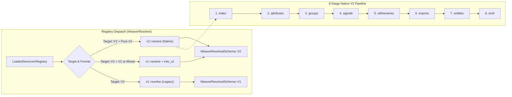

# Telemetry Schema Resolution Process

Resolution Process Status:

- Semantic Convention Registry: **Fully Implemented**
- Application Telemetry Schema: **Partially Implemented**

This crate implements the resolution process for OpenTelemetry telemetry schemas and
semantic convention registries. Resolution takes unresolved semantic convention specifications
and/or application telemetry schemas and produces an optimized, self-contained, and consistent
resolved schema (`WeaverResolvedSchema`, either V1 or V2).

Resolved schemas are used to validate live telemetry data, generate documentation and code, and
perform consistency and policy checks.

## Architecture

The crate is structured into three primary submodules with strict separation of concerns:

- **`graph/` (Shared, Version-Neutral)**:
  Handles version-agnostic loading and dependency-graph operations:
  - `loader.rs`: File and manifest loading, registry `SourceFormat` detection (`V1`, `V2`, or `Mixed`).
  - `conflict_strategy.rs`: SemVer conflict resolution policies across transitive dependencies.
  - `chosen_versions.rs`: Chosen-version linearization and `SchemaLookupContext`.
  - `entity_lookup.rs`: Version-neutral entity location and resolution tracking.
  - `exclusion.rs` and `merge.rs`: Dependency exclusion checks and annotation deep-merging.

- **`v1/` (Legacy Iterative Resolution Engine)**:
  An iterative resolution engine that resolves registries by repeatedly expanding `extends` and
  attribute `ref` clauses until a fixed point is reached.
  - Resolves all pure-V1 registries and mixed V1+V2 registries, returning `WeaverResolvedSchema::V1`.
  - Supports dependency reading via traits in `v1/dependency/`, adapting both V1 dependencies
    (`v1_dep.rs`) and V2 dependencies (`v2_dep.rs`).
  - When `--v2` is requested on a mixed or V1 registry, `weaver_resolver` resolves through V1 and converts the resulting root schema to `WeaverResolvedSchema::V2` (`WeaverResolvedSchema::into_v2` is also available when converting a `ResolutionTarget::V1` result).

- **`v2/` (Native V2 Resolution Engine)**:
  The resolution engine used when resolving pure `definition/2` registries with `--v2`
  (`ResolutionTarget::V2`).
  - Emits `weaver_resolved_schema::v2::ResolvedTelemetrySchema` directly without V1 intermediate lowering.
  - Pure-V2 dependency graphs execute zero V1 code.
  - Interacts with dependencies exclusively through the traits defined in `v2/dependency/`.

For a comprehensive specification of V2 resolution semantics, lookup and visibility rules, refinement inheritance, and dependency upgrade behaviors, see [`docs/v2-resolution.md`](docs/v2-resolution.md).

### Resolution Dispatch and V2 Pipeline



### Native V2 Resolution Pipeline

The native V2 engine executes a deterministic, numbered multi-stage pipeline:

1. **`index` (`v2::index`)**: Builds per-namespace symbol tables for local attributes, attribute groups,
   spans, metrics, events, and entities, validating against duplicate definitions and normalized ID collisions.
2. **`attributes` (`v2::attributes`)**: Resolves local attribute definitions into the catalog and constructs
   the native attribute catalog against linearized dependencies.
3. **`groups` (`v2::groups`)**: Expands attribute groups and resolves nested `ref_group` DAG inclusions.
4. **`signals` (`v2::signals`)**: Resolves base signals (spans, metrics, events, entities), their attribute
   references, span name templates, and entity identity requirements.
5. **`refinements` (`v2::refinements`)**: Resolves signal and entity refinements against local or dependency
   parents, evaluating inheritance, overrides, `unref` removals, span templates, and identity invariance per `v2::rules`.
6. **`imports` (`v2::imports`)**: Resolves explicit and wildcard imports from dependencies, handling diamond
   deduplication, checked upgrades, and `--include-unreferenced`.
7. **`entities` (`v2::entities`)**: Resolves entity associations on signals and refinements, tracking provenance
   origins across dependency boundaries.
8. **`emit` (`v2::emit`)**: Infallibly assembles and sorts the final
   `weaver_resolved_schema::v2::ResolvedTelemetrySchema`.

### Dependency Adapter Boundaries

Each engine accesses dependencies through adapter traits:
- `v1/dependency/v2_dep.rs` allows the V1 resolver to read resolved V2 dependency schemas.
- `v2/dependency/v1_dep.rs` allows the native V2 resolver to read resolved V1 dependency schemas.
  This file is the **sole file** in `src/v2/` permitted to reference external V1 types (`weaver_semconv::v1`
  or `weaver_resolved_schema::v1`), enforced by automated boundary lint tests.

## Golden V2 snapshots

The integration tests [`tests/v2_goldens.rs`](tests/v2_goldens.rs) and [`tests/v2_parity.rs`](tests/v2_parity.rs)
verify schema correctness and engine parity:
- `test_v2_goldens` resolves fixtures using `ResolutionTarget::V1` (legacy engine converted to V2) and compares output semantically against golden snapshot files.
- `test_v2_goldens_native_engine` resolves fixtures using `ResolutionTarget::V2` (native V2 engine) against the same golden snapshots.
- `tests/v2_parity.rs` performs exhaustive end-to-end parity assertions between `ResolutionTarget::V1` and `ResolutionTarget::V2` across all test fixtures and error conditions.

- **Golden files**:
  - `expected-schema.yaml`: Serde-saphyr YAML representation of the resolved V2 `ResolvedTelemetrySchema`.
  - `expected-errors.json`: Expected fatal resolution error (compared via canonicalized JSON string equality).
  - `expected-warnings.json`: Optional per-fixture non-fatal warnings that are intentionally emitted during resolution.
- **Discovery by convention**: Any directory under `data/` containing either `expected-schema.yaml` or
  `expected-errors.json` is automatically discovered as a test case. The registry path to resolve is
  `<test_dir>/registry`.
- **Coverage guard**: A guard test verifies that every top-level directory in `data/` is either covered
  by a discovered test case or explicitly listed in a `SKIP_LIST` with a documented reason.
- **Semantic comparison**: Schema comparison deserializes the expected YAML into `ResolvedTelemetrySchema`
  and compares `serde_json::to_value(expected) == serde_json::to_value(observed)`. Key ordering in objects
  is irrelevant, but array order remains significant (e.g. span name template evaluation order, attribute
  catalog indices, enum member order). On mismatch, the test prints a colored unified diff.
- **Warnings policy**: By default, unexpected non-fatal errors fail the test. The harness ignores a fixed set
  of known non-fatal warnings (`UnstableFileFormat`, `LegacyRegistryManifest`, `DeprecatedVersionField`,
  `MissingManifestFileFormat`, and `InvalidGroupUsesPrefix` for prefix fixtures). Any additional non-fatal
  warnings must be captured in `expected-warnings.json`.
- **Per-fixture settings**: An optional `settings.yaml` can be placed in any test directory to configure:
  - `schema_url`: Fixed schema URL for the registry.
  - `schema_url_overrides`: Map of schema URLs to local directory paths.
- **Fixture intent documentation**: Each fixture directory maintains a `README.md` explaining the tested
  behavior, invariants, and purpose of the fixture.
- **Observed output**: Each test run writes observed schemas to `observed_output/<test_dir>/schema.yaml`
  (legacy path) and `observed_output_native/<test_dir>/schema.yaml` (native V2 path), both gitignored, for inspection.
- **Snapshot regeneration**: When a change intentionally alters resolved schemas or warnings, regenerate
  snapshots with:

```bash
cargo test -p weaver_resolver --test v2_goldens -- --ignored regenerate_v2_goldens
```

Regeneration is an explicit, ignored test rather than an environment variable, so normal `cargo test` runs
never rewrite snapshots. Existing golden schemas that already match are never overwritten. See also
[CONTRIBUTING.md](../../CONTRIBUTING.md#how-to-build-and-test-a-change).

## Lineage (experimental, V1 only)

> **Note**: `GroupLineage` (`lineage`) applies only to V1 resolved schemas (`weaver_resolved_schema::v1`);
> V2 resolved schemas (`weaver_resolved_schema::v2`) record definition origins via `Provenance`.
> The lineage feature is experimental and has not yet been fully
> discussed with the OpenTelemetry community.
> The intent is to include the lineage information in the resolved application
> telemetry schema to provide a way to trace the origin of each field in the
> schema. A discussion will be opened in the OpenTelemetry community to discuss
> the inclusion of this feature as an optional part or as a mandatory part of
> the resolved schema.

The resolution process can optionally compute the lineage for each attribute of
a semantic convention registry. The lineage as such is not part of the syntax
and structure of a semantic convention; rather, it's an extension produced by
the `weaver` tool, intended for use in scenarios such as:

- A semconv author wishes to verify the exact path followed by the resolution
  process in the case of a complex cascade of inheritance across multiple levels
  between groups.
- A documentation process aims to add lineage information to the documentation
  of each attribute to allow readers to understand where the definitions of each
  field were defined.
- The lineage information of a semantic convention could eventually feed into
  an enterprise data catalog to improve the data governance process.

The general structure of the lineage generated by the resolution process is as
follows:

```json5
{
  "registry_url": "<registry url>",
  "groups": [
    {
      // Standard semconv fields 
      "id": "<group id>",
      "type": "<group type>",
      "brief": "<group brief>",
      "attributes": [
        /* ... */
      ],
      "lineage": {
        // `source_file` is either:
        // - a relative path in the case of a registry that has been explicitly
        // resolved from a directory in the file system. This type of registry
        // is mainly used in unit tests, where using a relative path makes
        // these tests independent of where they are executed.
        // - an absolute URL when the resolution applies to a registry
        // accessible from a GitHub repository, for example.
        "source_file": "<path or url>",
        "attributes": {
          "<attribute id>": {
            // The group ID where the attribute fields were defined before a
            // possible local redefinition. In the case of an inherited
            // attribute, this field contains the ID of the group defined in
            // the `extends` clause of the initial definition. In the case of
            // a reference to a root attribute, this field contains the ID of
            // the group where this attribute was defined globally.
            "source_group": "<group id>",
            // The field names inherited from the source group. This field is
            // present only if the attribute is inherited.
            // We assume all are inherited unless overridden.
            "inherited_fields": [
              "<field name>",
              /* ... */
            ],
            // The field names overridden in the local group.
            "locally_overridden_fields": [
              "<field name>",
              /* ... */
            ],
          }
        }
      }
    }
  ]
}
```

Important note: Attributes that appear in the group but are not mentioned in the
lineage, by convention, have the lineage of the current group.

With this information, it is possible for each field of an attribute to trace
inheritance relationships, overrides or local redefinitions, global references
to attributes. The definition of an attribute's fields can be a complex mix of
definitions coming from several attribute groups.

> **Open question/concern**: Handling of relative paths versus absolute URLs in
> application telemetry schema resolution. The concern addresses the evolution
> of file references within the schema, questioning whether a consumer retains
> these as relative paths or converts them to absolute URLs based on the
> original source's location. The issue is illustrated through the process
> where the Semantic Convention (Semconv) resolves its metrics with lineage via
> relative paths, and Application A subsequently creates its own schema using
> Semconv. The core question is whether lineage references will display relative
> paths, URLs, or both. Additionally, there's worry about the scalability of
> using the `source_file` string field to track origins as resolutions progress
> from Semconv to application levels. 