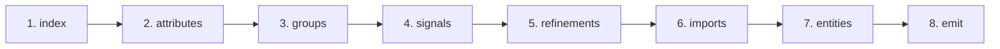

# OpenTelemetry Weaver: Native V2 Resolution Design & Specification

This document is the authoritative architectural reference for OpenTelemetry Semantic Convention V2 resolution in `weaver_resolver`.

---

## 1. Overview and Dispatch Matrix

Resolution in Weaver translates semantic convention definitions and application telemetry schemas into fully resolved, self-contained schema models (`weaver_resolver::WeaverResolvedSchema`, wrapping either `weaver_resolved_schema::v1::ResolvedTelemetrySchema` or `weaver_resolved_schema::v2::ResolvedTelemetrySchema`).

The resolver operates in two fundamental modes configured by `ResolutionTarget`:
- `ResolutionTarget::V1`: Legacy iterative resolution engine producing `WeaverResolvedSchema::V1` (or converting to V2 when requested).
- `ResolutionTarget::V2`: Native V2 pipeline producing `WeaverResolvedSchema::V2` directly without intermediate V1 lowering.

### Dispatch Rules

Each unresolved registry's source format is inspected during loading:
- `SourceFormat::V2`: Every specification file in the registry is `definition/2`.
- `SourceFormat::V1`: Every specification file in the registry is `definition/1`.
- `SourceFormat::Mixed`: The registry contains a combination of `definition/1` and `definition/2` files.

The resolution path is dispatched according to the following matrix:

| `ResolutionTarget` | Registry Format | Resolution Engine (`weaver_resolver`) | `WeaverResolver` Return Variant | Informational Warnings |
|---|---|---|---|---|
| `V2` | Pure `definition/2` (`SourceFormat::V2`) | **Native V2 Engine** (`v2::resolve`) | `WeaverResolvedSchema::V2` | None |
| `V2` | Mixed (`SourceFormat::Mixed`) | Legacy V1 Engine (`v1::resolve`) + V1→V2 conversion | `WeaverResolvedSchema::V2` | `MixedRegistryUsesV1Path` |
| `V2` | Pure `definition/1` (`SourceFormat::V1`) | Legacy V1 Engine (`v1::resolve`) + V1→V2 conversion | `WeaverResolvedSchema::V2` | None |
| `V2` | Published `resolved/2.0` | Loader direct pass-through | `WeaverResolvedSchema::V2` | None |
| `V1` | Any definition format | Legacy V1 Engine (`v1::resolve`) | `WeaverResolvedSchema::V1` | None |

### Mixed & Dependency Informational Warnings under `--v2`

1. **Root Mixed Registry (`MixedRegistryUsesV1Path`)**:
   When `--v2` (`ResolutionTarget::V2`) is requested for a registry containing both V1 and V2 files, Weaver emits an informational warning:
   > *"Registry \`{schema_url}\` mixes definition/1 and definition/2 files; using the V1 resolution path"*
   This is non-fatal and informs the user why native V2 pipeline semantics are bypassed.

2. **V1 or Mixed Dependency under Pure V2 (`V1DependencyUsesV1Path`)**:
   When a pure-V2 registry resolves with `--v2`, its dependencies are resolved recursively. If any dependency is V1 or mixed format, that dependency resolves via V1 and Weaver emits an informational warning naming the dependency's schema URL:
   > *"Dependency \`{schema_url}\` uses {format} format; using the V1 resolution path"*
   Warnings are deduplicated per dependency schema URL. The root registry continues resolving natively via V2, reading the resolved V1 dependency schema through the adapter at `v2/dependency/v1_dep.rs`.

---

## 2. The 8-Stage Native V2 Pipeline

The native V2 engine executes an explicit 8-stage deterministic pipeline in `crates/weaver_resolver/src/v2/mod.rs`:



### Pipeline Stages

1. **`index` (`v2::index`)**:
   - Scans all local `SemConvSpecWithProvenance` specifications in deterministic sorted path order (note: duplicate inline `- ref:` entries within a single definition are already rejected as fatal `DuplicateAttributeRef` errors during spec loading in `weaver_semconv::v2::SemConvSpecV2::validate`).
   - Builds isolated, typed symbol tables and rejects duplicates as fatal errors:
     - `attributes`: local attribute definitions (`DuplicateAttributeId`).
     - `attribute_groups`: local attribute groups (`DuplicateGroupId`).
     - `spans`, `metrics`, `events`, `entities`: base signals and refinements, including normalized base-vs-refinement ID collisions (`DuplicateGroupId`, `DuplicateGroupName`, `DuplicateMetricName`).
   - Handles `--include-unreferenced` by generating an implicit wildcard import with typed `ImportOrigin::IncludeUnreferenced` (emitting `DeprecatedIncludeUnreferencedWarning`).

2. **`attributes` (`v2::attributes`)**:
   - Constructs the `Catalog` holding local and dependency attributes (after `v2::resolve` linearizes the dependency graph and pins chosen versions).
   - Defines all local attributes in the catalog.
   - Local definitions take precedence over dependency attributes with identical keys (local shadowing).

3. **`groups` (`v2::groups`)**:
   - Expands attribute groups by recursively resolving nested `ref_group` references (bounded by `MAX_REF_GROUP_DEPTH = 64`).
   - Detects cycles and excessive nesting depth in group inclusion graphs (`AttributeGroupCycle`).
   - Deduplicates diamond `ref_group` inclusions that originate from the same attribute group; rejects attribute key collisions across distinct included groups as fatal `DuplicateAttributeId`.
   - Propagates `dependency_resolution.exclude: true` taint across `visibility: internal` groups so non-excluded public signals cannot launder excluded groups.
   - Warns when `ref_group` targets a span, metric, or event signal instead of an attribute group (`DeprecatedSignalRefGroup`). Targeting an entity (`entity.<id>`) via `ref_group` is rejected with `UnresolvedRefGroup` because entities partition attributes into `identity` and `description` roles.

4. **`signals` (`v2::signals`)**:
   - Resolves all base signals (`spans`, `metrics`, `events`, `entities`).
   - Expands inline `ref_group` entries and direct `- ref:` attribute references.
   - Applies attribute-reference overrides, calculates requirement levels, and validates base span name templates (`SpanNameAttributeNotOnSpan`) and base entity identities (`EntityMissingIdentity`).

5. **`refinements` (`v2::refinements`)**:
   - Resolves signal and entity refinements against base signals or other refinements of the same kind (chained refinements), located locally or in dependencies.
   - Enforces same-kind parent constraints (`InvalidRefinement`) and validates refinement parent existence (`UnresolvedRefinementParent`).
   - Applies inheritance rules, `unref` removals, span name template validation, and entity identity invariance (`EntityRefinementWithoutIdentity`, `EntityRefinementChangedIdentity`).

6. **`imports` (`v2::imports`)**:
   - Matches explicit and wildcard import patterns against dependencies.
   - Deduplicates items imported via diamond dependency paths sharing the same origin schema.
   - Rejects rival imported definitions from distinct origins, local-vs-imported collisions, and imported-signal-vs-local-refinement ID collisions as fatal errors (`DuplicateGroupId`, `DuplicateMetricName`, `DuplicateGroupName`).
   - Skips dependency items marked with `dependency_resolution.exclude: true`.
   - Emits a non-fatal `UnmatchedImport` warning when an explicit import pattern matches no dependency item.
   - Applies checked dependency upgrades (`AttributeNotFoundInUpgradedSchema`, `GroupNotFoundInUpgradedSchema`, `EntityNotFoundInUpgradedSchema`).

7. **`entities` (`v2::entities`)**:
   - Resolves `entity_associations` across all signals, refinements, and imported items (bounded by `MAX_ENTITY_ASSOC_DEPTH = 64`).
   - Preserves association origins so inherited or imported associations retain their source schema URLs.
   - Verifies that private local entities are only referenced by private local signals.

8. **`emit` (`v2::emit`)**:
   - Infallibly assembles and emits the final `weaver_resolved_schema::v2::ResolvedTelemetrySchema` from the validated catalog, signals, refinements, imports, and linearized `dependencies`.
   - Populates and sorts signals, public attribute groups, and refinement lookup tables (sorted by normalized `id`).

---

## 3. Lookup and Visibility Rules

The V2 resolver implements precise visibility and resolution rules:

| Rule | Scope | Description & Error Diagnostics |
|---|---|---|
| **Attribute `ref` Lookup** | Local & Dependencies | Look up attribute key in local definitions first. If not found locally, look up in dependencies. Same-registry compatible versions are arbitrated using graph-wide chosen versions (`UseLatestMajorVersion`), while cross-major conflicts of the same registry fail during dependency loading with `IncompatibleDependencyVersions`. When two distinct registries define the same attribute key, lookup fails with `AmbiguousReference`. Local definitions shadow dependency definitions. |
| **Refinement Parent Lookup** | Local & Dependencies | Look up the parent signal or parent refinement by ID. The parent must be of the **same signal kind** (metric, span, event, entity); chained refinements (`ref:` targeting another refinement, locally or in a dependency) are supported. If the parent ID matches an item of a different kind, resolution fails with `InvalidRefinement`. If no parent is found in the local registry or dependencies, resolution fails with `UnresolvedRefinementParent`. |
| **`ref_group` Expansion** | Local & Dependency Attribute Groups | `ref_group` references an `attribute_group` by its `id`. Group inclusions form a DAG bounded at depth 64 (`MAX_REF_GROUP_DEPTH`); cycles or excessive depth fail with `AttributeGroupCycle`. Diamond inclusions sharing the same origin group are deduplicated; distinct groups providing the same attribute key fail with `DuplicateAttributeId`. Referencing a span, metric, or event via `ref_group` is deprecated and emits `DeprecatedSignalRefGroup`; referencing an entity (`entity.<id>`) fails with `UnresolvedRefGroup`. |
| **Dependency Exclusion (`exclude: true`)** | Cross-Registry vs Local | When an item is marked `dependency_resolution.exclude: true`, it is completely invisible across dependency boundaries. Dependents attempting to reference it fail as if the item does not exist (`UnresolvedAttributeRef`, `UnresolvedRefinementParent`, `UnresolvedEntityAssociation`, `UnmatchedImport`), preventing internal private API details from leaking. Wildcard imports silently skip excluded items. Within the defining registry, referencing an excluded item from a non-excluded item fails with `ExcludedFromDependencyResolution`. |
| **Internal Groups (`visibility: internal`)** | Defining Registry Only | Attribute groups marked `visibility: internal` may be included locally by signals or other groups within the registry. Internal groups are never emitted into the resolved schema's public `attribute_groups` and cannot be imported by dependent registries. |
| **Entity Association Resolution** | Signals & Refinements | An entity association name resolves to a local entity type or local entity refinement, then to dependencies. Imported or inherited associations preserve their original resolved provenance (`SchemaUrl`). Private local entities may only be associated with private local signals. |
| **Checked Dependency Upgrades** | Linearized Dependencies | When SemVer arbitration selects a compatible newer version of a dependency, all items (attributes, groups, refinement parents, entity associations) are validated against the upgraded version. If an item was removed in the chosen version, resolution fails immediately (`AttributeNotFoundInUpgradedSchema`, `GroupNotFoundInUpgradedSchema`, `EntityNotFoundInUpgradedSchema`). |
| **Implicit Imports (`--include-unreferenced`)** | CLI Option | Enabled via `--include-unreferenced`. Creates an implicit wildcard import with typed origin `ImportOrigin::IncludeUnreferenced`. Implicit imports never trigger `UnmatchedImport` warnings even when dependencies contain no items for a given signal kind. Emits `DeprecatedIncludeUnreferencedWarning`. |

---

## 4. Refinement Inheritance Rules

Refinements modify or specialize base signals. The native V2 engine applies field inheritance strictly according to the following table:

| Field | Rule | Target Signal Kinds | Details |
|---|---|---|---|
| `instrument`, `unit`, metric `name` | **Fixed from parent** | Metric | Cannot be overridden by metric refinements. Always inherited from parent. |
| event `name` | **Fixed from parent** | Event | Event refinements inherit the refined event's `name` (`id` uniquely identifies the refinement). |
| `kind` | **Fixed from parent** | Span | Span kind (`Internal`, `Server`, `Client`, `Producer`, `Consumer`) cannot be modified by refinements. |
| entity `type` | **Fixed from parent** | Entity | Entity type cannot be changed by refinements. |
| signal `requirement_level` | **Fixed from parent** | All signals | Base signal requirement level is immutable in refinements. |
| `brief` | **Inherit if unset or empty** | All signals | If refinement provides a non-empty `brief`, it overrides; otherwise inherits parent's `brief`. |
| `note` | **Inherit if unset** | All signals | If refinement explicitly specifies `note` (even an empty string `""`), it overrides. If omitted (`None`), parent's `note` is inherited. |
| `stability` | **Inherit if unset** | All signals | Overrides if specified on refinement; otherwise inherited from parent. |
| `deprecated` | **Inherit if unset** | All signals | Overrides if specified on refinement; otherwise inherited from parent. |
| span `name` | **Inherit if unset; replace whole** | Span | If refinement specifies `name`, the entire `SpanName` structure replaces the parent's. Otherwise parent's `name` is inherited. |
| `annotations` | **Deep merge** | All signals | Parent annotations are deep-merged with refinement annotations. On collision of leaf keys, refinement values win. |
| `entity_associations` | **Inherit if unset; replace whole** | Span, Metric, Event | If `entity_associations` is omitted (`None`), the refinement inherits the parent's associations. If `entity_associations` is specified (including an empty list `[]`), that list replaces the parent's associations. Inherited associations retain their original resolved provenance. |
| `attributes` | **Precedence: parent < `ref_group` < inline `ref`** | All signals & Entity description | Attribute definitions and overrides merge as described in [Attribute-Reference Overrides](#5-attribute-reference-overrides). Inline `ref:` has the highest precedence, followed by included `ref_group`, followed by parent attributes. |
| `unref` | **Explicit removal** | Refinements only | Removes an inherited attribute. Fails if the attribute is not inherited from parent, is required by parent, is also referenced locally, is included by a local `ref_group`, is a duplicate `unref`, or identifies an entity. |
| entity `identity` | **Immutable set of attributes** | Entity | Refinements cannot add, remove, promote, or demote identity attributes. A parent without identity fails with `EntityRefinementWithoutIdentity`. Altering identity fails with `EntityRefinementChangedIdentity`. |

---

## 5. Attribute-Reference Overrides

When an attribute is referenced on a signal, refinement, attribute group, or entity, specific fields may be customized:

| Attribute Field | Permitted on `ref:` | Behavior & Constraints |
|---|---|---|
| `brief` | Yes | Overrides definition's brief if specified; otherwise inherits definition's brief. |
| `note` | Yes | Overrides definition's note if specified; otherwise inherits definition's note. |
| `examples` | Yes | Overrides definition's examples if specified; otherwise inherits definition's examples. |
| `annotations` | Yes | Deep-merged with definition annotations; reference annotations take precedence. |
| `requirement_level` | Yes | Overrides requirement level. Defaults to `recommended` if omitted. Entity identity attributes are always `required`. |
| `sampling_relevant` | Yes (Spans only) | Per-span sampling hint. Overrides if present. |
| `type` | **No (Forbidden)** | Type is defined exclusively on the attribute definition. |
| `stability` | **No (Forbidden)** | Stability is defined exclusively on the attribute definition. |
| `deprecated` | **No (Forbidden)** | Deprecation is defined exclusively on the attribute definition. |

> [!IMPORTANT]
> **Duplicate Inline References**: Specifying duplicate `- ref:` entries for the same attribute key within a single signal, attribute group, entity, or refinement is rejected as a fatal `DuplicateAttributeRef` error.

---

## 6. Architectural Boundary and Isolation Guarantees

The native V2 resolver enforces strict module isolation:

```
crates/weaver_resolver/src/
├── v1/                       # Legacy V1 resolution engine
│   ├── dependency/
│   │   ├── v1_dep.rs         # Reads V1 dependencies
│   │   └── v2_dep.rs         # Reads V2 dependencies
│   └── ...
└── v2/                       # Native V2 resolution engine
    ├── dependency/
    │   ├── v1_dep.rs         # Sole file permitted to reference V1 types
    │   └── v2_dep.rs         # Direct native adapter for V2 dependencies
    └── ...
```

### Boundary Guarantees

1. **Zero `crate::v1` Imports in `v2/`**:
   No file in `crates/weaver_resolver/src/v2/` is permitted to import from `crate::v1`.
2. **Single Bridge File (`v2/dependency/v1_dep.rs`)**:
   `v2/dependency/v1_dep.rs` is the **only file** in the entire `v2/` hierarchy allowed to reference external V1 types (`weaver_semconv::v1` or `weaver_resolved_schema::v1`).
3. **Automated Enforcement**:
   - `test_v2_boundary_no_v1_imports` in `crates/weaver_resolver/src/v2/mod.rs` scans all Rust source files in `src/v2/` and enforces that no forbidden V1 imports exist.
   - `DisallowV1AdapterScope` and `DisallowV1EngineScope` provide compile-time and runtime validation harnesses in tests to ensure that pure-V2 resolution never activates V1 adapters or engine paths.
